# Jarkom-Modul-2-2026-K-55

## Anggota

| Nama | NRP |
| --- | --- |
| Arjunina Maqbulin Usman | 5027251007 |
| M. Rama Maulana Wafa | 5027251019 |
---

## Topologi dan Rencana IP

Image: `ardhptr21/debinet:latest` untuk jichi, tengen, utahime, shoko, gojo, geto, worker, dan database. `ardhptr21/alpinet:latest` untuk seluruh client.

| Network | Subnet | Gateway | Fungsi |
|---|---|---|---|
| 1 | `10.91.1.0/24` | `10.91.1.1` | DMZ |
| 2 | `10.91.2.0/24` | `10.91.2.1` | Client Divisi A (DHCP relay) |
| 3 | `10.91.3.0/24` | `10.91.3.1` | Client Divisi B (DHCP relay) |
| 4 | `10.91.4.0/24` | `10.91.4.1` | Data Center |

Soal tidak menentukan nomor host, sehingga IP host dipilih sendiri dan dipakai konsisten di semua soal.

| Network | Host | IP | Gateway |
|---|---|---|---|
| 1 | utahime | 10.91.1.2 | 10.91.1.1 |
| 1 | shoko | 10.91.1.3 | 10.91.1.1 |
| 1 | gojo | 10.91.1.4 | 10.91.1.1 |
| 4 | geto | 10.91.4.2 | 10.91.4.1 |
| 4 | maki | 10.91.4.3 | 10.91.4.1 |
| 4 | panda | 10.91.4.4 | 10.91.4.1 |
| 4 | nanami | 10.91.4.5 | 10.91.4.1 |
| 4 | todo | 10.91.4.6 | 10.91.4.1 |
| 4 | kirara | 10.91.4.7 | 10.91.4.1 |
| 4 | yaga | 10.91.4.8 | 10.91.4.1 |
| 4 | inumaki | 10.91.4.9 | 10.91.4.1 |
| 4 | tengen | 10.91.4.10 | 10.91.4.1 |

Pada awalnya tengen memakai `10.91.4.8`. Karena soal 2 mewajibkan DHCP server berada di `[PREFIX].4.10`, IP yaga, inumaki, dan tengen disesuaikan menjadi seperti tabel di atas.

### Tabel Pemetaan Kabel

| Node 1 | Port | Node 2 | Port |
|---|---|---|---|
| NAT1 | nat0 | jichi | eth0 |
| jichi | eth1 | Switch1 | e0 |
| jichi | eth2 | Switch2 | e0 |
| jichi | eth3 | Switch4 | e0 |
| jichi | eth4 | Switch6 | e0 |
| Switch1 | e1 / e2 / e3 | utahime / shoko / gojo | eth0 |
| Switch2 | e1 / e2 | Switch3 / Switch9 | e0 |
| Switch3 | e1 / e2 | itadori / fushiguro | eth0 |
| Switch9 | e1 / e2 | zenin / okkotsu | eth0 |
| Switch4 | e1 / e2 | Switch5 / Switch8 | e0 |
| Switch5 | e1 / e2 | ino / kusakabe | eth0 |
| Switch8 | e1 / e2 | kugisaki / miwa | eth0 |
| Switch6 | e1 / e2 | Switch7 / Switch10 | e0 |
| Switch7 | e1-e6 | geto / maki / panda / nanami / todo / kirara | eth0 |
| Switch10 | e1 / e2 / e3 | tengen / yaga / inumaki | eth0 |

Topologi GNS3:

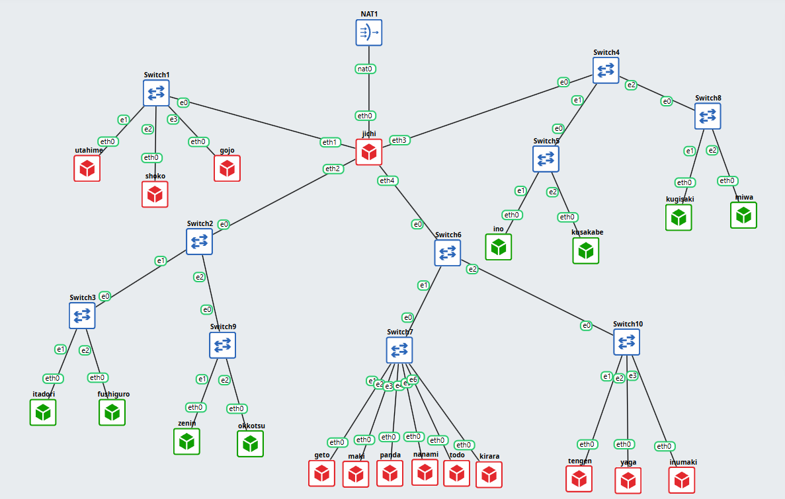

---

## Soal 1

### Tujuan

Mengonfigurasi `jichi` agar `eth0` memperoleh WAN dari NAT dan `eth1`-`eth4` menjadi gateway Network 1-4. IPv4 forwarding dan source NAT diaktifkan, lalu IP statis host infrastruktur ditetapkan dan konektivitasnya dibuktikan.

### Konfigurasi jichi (`/etc/network/interfaces`)

```conf
auto lo
iface lo inet loopback

auto eth0
iface eth0 inet dhcp

auto eth1
iface eth1 inet static
    address 10.91.1.1
    netmask 255.255.255.0

auto eth2
iface eth2 inet static
    address 10.91.2.1
    netmask 255.255.255.0

auto eth3
iface eth3 inet static
    address 10.91.3.1
    netmask 255.255.255.0

auto eth4
iface eth4 inet static
    address 10.91.4.1
    netmask 255.255.255.0
```

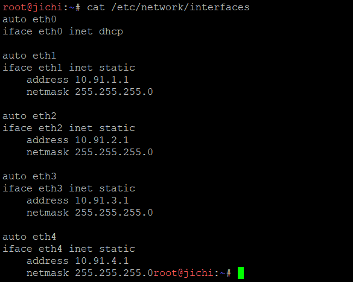

Isi `/etc/network/interfaces` pada jichi.

### IP forwarding dan NAT (`/root/init.sh` jichi)

```bash
#!/bin/bash

echo "nameserver 192.168.122.1" > /etc/resolv.conf

sysctl -w net.ipv4.ip_forward=1
grep -q "^net.ipv4.ip_forward=1" /etc/sysctl.conf 2>/dev/null || echo "net.ipv4.ip_forward=1" >> /etc/sysctl.conf
sysctl -p

apt-get update -y
apt-get install -y iptables
iptables -t nat -C POSTROUTING -o eth0 -j MASQUERADE 2>/dev/null || \
iptables -t nat -A POSTROUTING -o eth0 -j MASQUERADE
```

- `ip_forward=1` membuat jichi meneruskan paket antar-subnet.
- `MASQUERADE` pada `eth0` memungkinkan subnet internal mengakses internet lewat NAT.

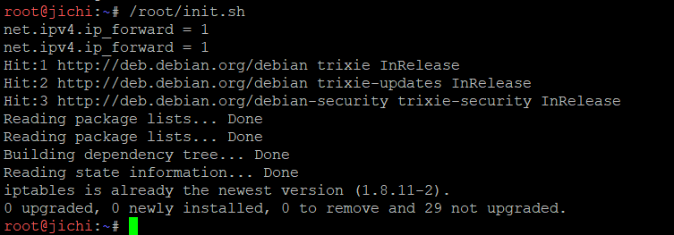

*Keterangan: Output `/root/init.sh` saat dijalankan di jichi.*

### Konfigurasi host infrastruktur

Contoh tengen (`/root/init.sh`). Hanya `address` dan `gateway` yang berbeda per host sesuai tabel IP.

```bash
#!/bin/bash

cat > /etc/network/interfaces <<EOF
auto lo
iface lo inet loopback

auto eth0
iface eth0 inet static
    address 10.91.4.10
    netmask 255.255.255.0
    gateway 10.91.4.1
EOF

echo "nameserver 192.168.122.1" > /etc/resolv.conf
```

### Verifikasi jichi

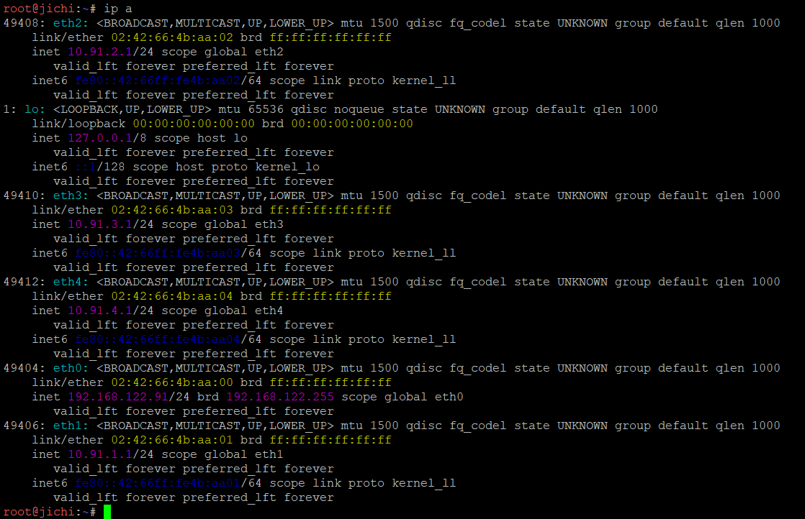

*Keterangan: `ip a` di jichi. `eth0` memperoleh IP dari NAT, `eth1`-`eth4` bernilai `10.91.1.1`-`10.91.4.1` dengan /24.*

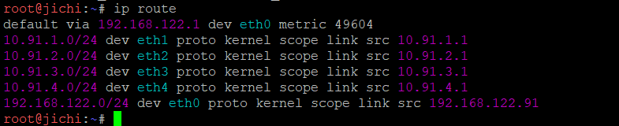

*Keterangan: `ip route` di jichi, memuat route ke empat subnet dan default route.*

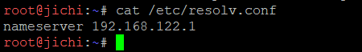

*Keterangan: `/etc/resolv.conf` berisi `nameserver 192.168.122.1`.*

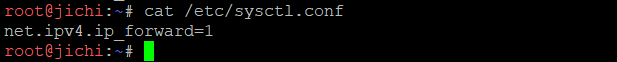

*Keterangan: `/etc/sysctl.conf` memuat `net.ipv4.ip_forward=1`.*

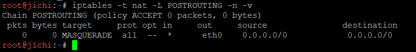

*Keterangan: Aturan MASQUERADE pada `eth0` dari `iptables -t nat -L POSTROUTING -n -v`.*

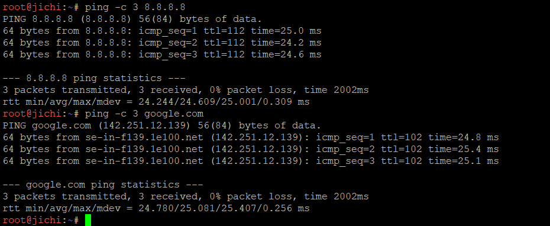

*Keterangan: Ping ke `8.8.8.8` dan `google.com` dari jichi berhasil.*

### Verifikasi host

**utahime (Network 1)**

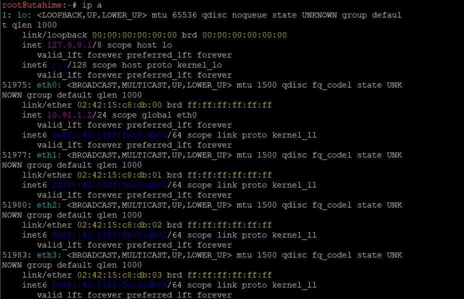

*Keterangan: `ip a` utahime, IP `10.91.1.2/24`.*

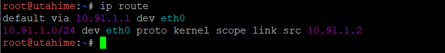

*Keterangan: `ip route` utahime, default route via `10.91.1.1`.*

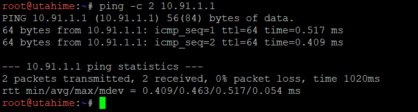

*Keterangan: Ping utahime ke gateway `10.91.1.1` berhasil.*

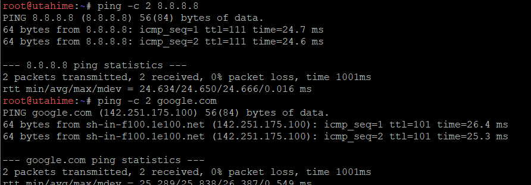

*Keterangan: Ping utahime ke `google.com` berhasil, membuktikan NAT dan DNS bekerja.*

**tengen (Network 4)**

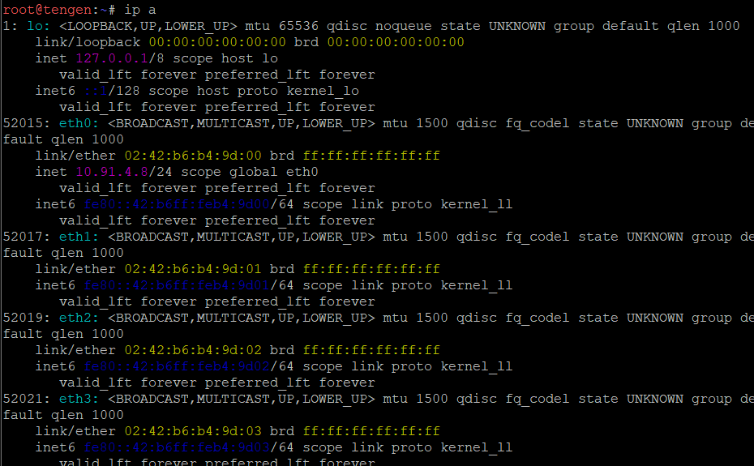

*Keterangan: `ip a` tengen, IP `10.91.4.10/24`.*

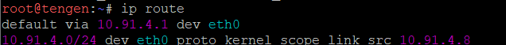

*Keterangan: `ip route` tengen, default route via `10.91.4.1`.*

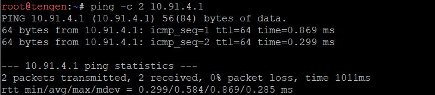

*Keterangan: Ping tengen ke gateway `10.91.4.1` berhasil.*

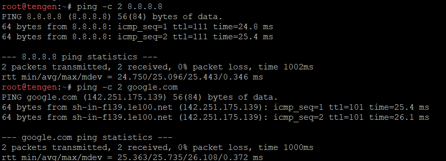

*Keterangan: Ping tengen ke `google.com` berhasil.*

---

## Soal 2

### Tujuan

Mengonfigurasi `isc-dhcp-server` pada tengen (`10.91.4.10`). Network 4 dideklarasikan sebagai subnet lokal tanpa pool, lalu disiapkan scope untuk Network 2 dan Network 3. Service harus aktif tanpa error `No subnet declaration`.

### Instalasi dan interface

```bash
apt-get update
apt-get install isc-dhcp-server -y
```

`/etc/default/isc-dhcp-server`:

```conf
INTERFACESv4="eth0"
```

### `/etc/dhcp/dhcpd.conf`

```conf
subnet 10.91.4.0 netmask 255.255.255.0 {
}

subnet 10.91.2.0 netmask 255.255.255.0 {
    range 10.91.2.100 10.91.2.200;
    option routers 10.91.2.1;
    option subnet-mask 255.255.255.0;
    option broadcast-address 10.91.2.255;
    option domain-name-servers 8.8.8.8;

    default-lease-time 600;
    max-lease-time 3600;
}

subnet 10.91.3.0 netmask 255.255.255.0 {
    range 10.91.3.100 10.91.3.200;
    option routers 10.91.3.1;
    option subnet-mask 255.255.255.0;
    option broadcast-address 10.91.3.255;
    option domain-name-servers 8.8.8.8;

    default-lease-time 600;
    max-lease-time 3600;
}
```

Blok `subnet 10.91.4.0` tanpa `range` mencegah error `No subnet declaration for eth0 (10.91.4.10)`, karena interface `eth0` berada di Network 4.

### Validasi dan menjalankan service

```bash
dhcpd -t
service isc-dhcp-server restart
service isc-dhcp-server status
```

### Verifikasi

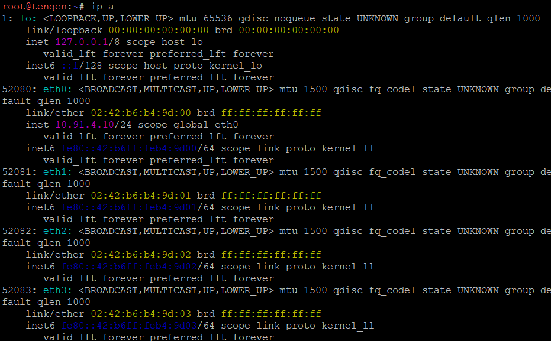

*Keterangan: `ip a` tengen, IP `10.91.4.10/24`.*

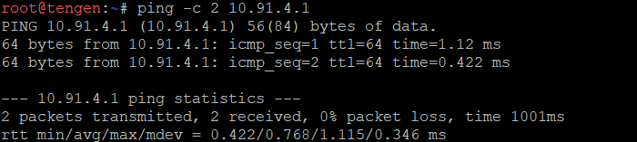

*Keterangan: Ping tengen ke gateway `10.91.4.1` berhasil.*

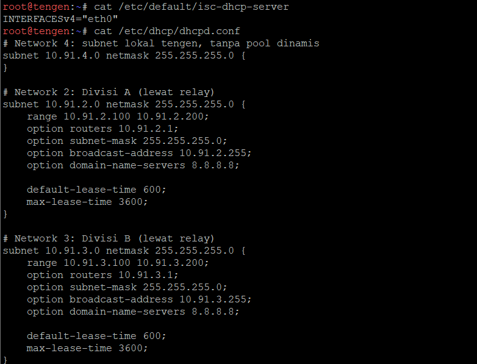

*Keterangan: Isi `/etc/default/isc-dhcp-server` dan `/etc/dhcp/dhcpd.conf` pada tengen.*

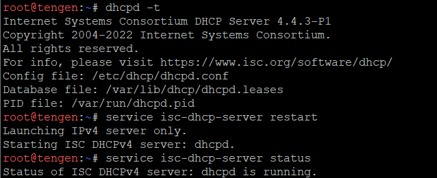

*Keterangan: `dhcpd -t` tanpa error dan status `dhcpd is running`, tanpa pesan `No subnet declaration`.*

---

## Soal 3

### Tujuan

Mengonfigurasi jichi sebagai DHCP Relay menuju tengen (`10.91.4.10`) dengan `eth2` untuk Network 2 dan `eth3` untuk Network 3, lalu membuktikan client kedua subnet memperoleh lease melalui relay.

### Konfigurasi relay di jichi

```bash
apt-get update
apt-get install isc-dhcp-relay -y
```

`/etc/default/isc-dhcp-relay`:

```conf
SERVERS="10.91.4.10"
INTERFACES="eth2 eth3 eth4"
OPTIONS=""
```

`eth4` ditambahkan karena relay perlu mendengar balasan dari tengen yang berada di Network 4, sesuai contoh modul (interface client dan interface menuju server).

```bash
service isc-dhcp-relay restart
ps aux | grep dhcrelay
sysctl net.ipv4.ip_forward
```

Pada container ini `service isc-dhcp-relay status` tidak mencetak output, sehingga bukti relay aktif diambil dari `ps aux`.

### Konfigurasi client

`/etc/network/interfaces` pada itadori dan ino:

```conf
auto eth0
iface eth0 inet dhcp
```

Lease diminta dengan `udhcpc -i eth0`.

### Verifikasi

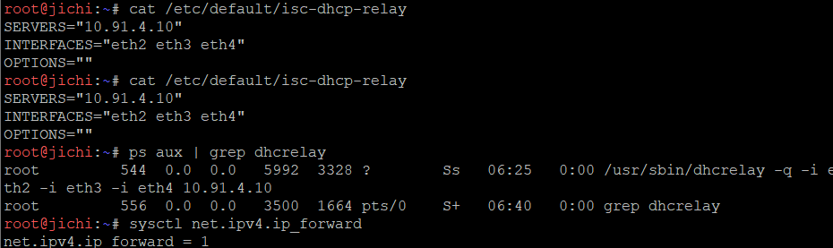

*Keterangan: `/etc/default/isc-dhcp-relay`, proses `dhcrelay -q -i eth2 -i eth3 -i eth4 10.91.4.10`, dan `ip_forward = 1`.*

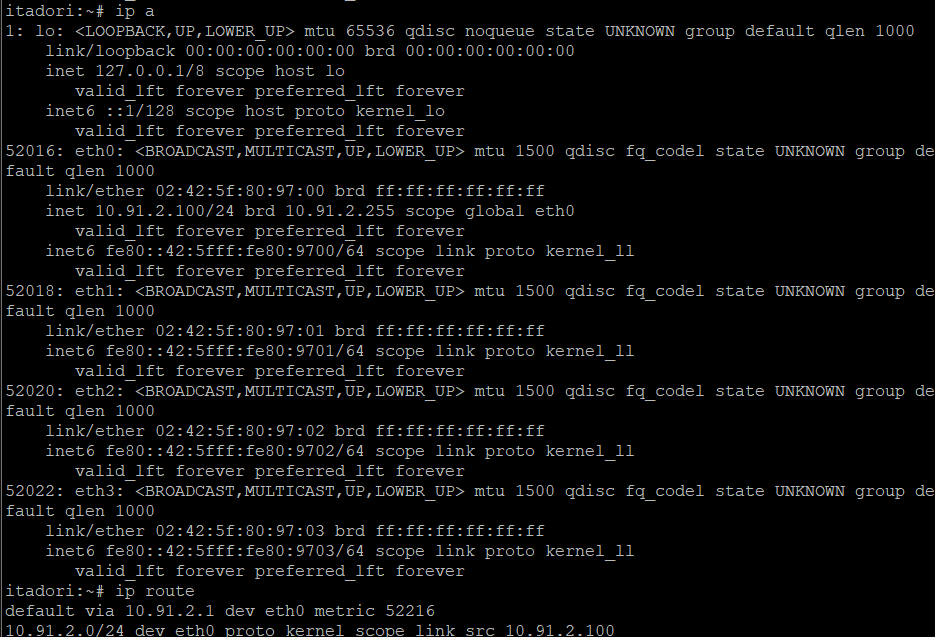

*Keterangan: itadori (Network 2) memperoleh `10.91.2.100/24` dengan default route via `10.91.2.1`.*

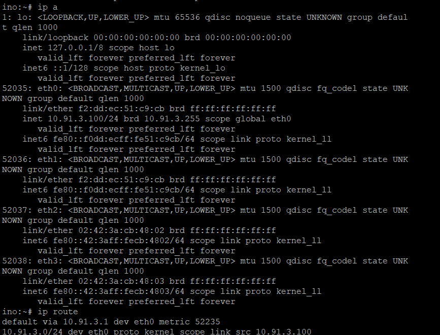

*Keterangan: ino (Network 3) memperoleh `10.91.3.100/24` dengan default route via `10.91.3.1`.*

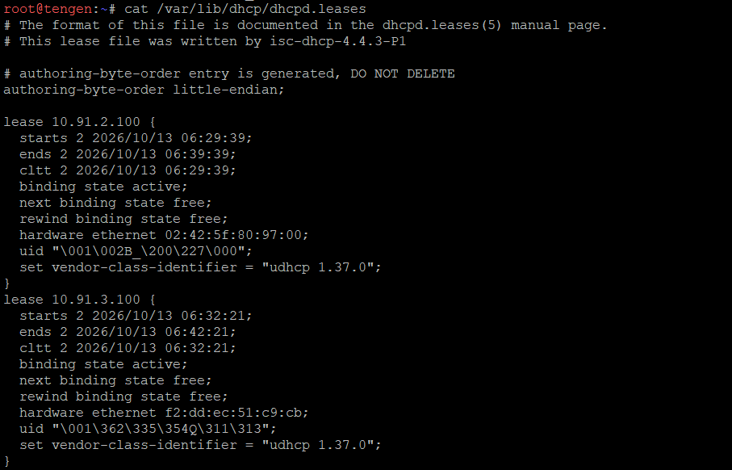

*Keterangan: `dhcpd.leases` di tengen memuat lease `10.91.2.100` dan `10.91.3.100` dengan MAC yang cocok dengan eth0 masing-masing client.*

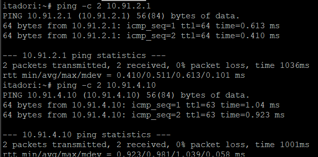

*Keterangan: Ping itadori ke gateway `10.91.2.1` dan ke tengen `10.91.4.10` berhasil.*

---

## Soal 4

### Tujuan

Membagi Network 2 menjadi dua pool:

| Pool | Range | Client |
|---|---|---|
| Pool 1 | `10.91.2.10`-`10.91.2.35` | itadori, fushiguro |
| Pool 2 | `10.91.2.70`-`10.91.2.95` | zenin, okkotsu |

Rentang `10.91.2.36`-`10.91.2.69` tidak boleh dialokasikan.

### MAC client (eth0)

| Client | MAC | Class |
|---|---|---|
| itadori | `02:42:5f:80:97:00` | pool1 |
| fushiguro | `02:42:3b:91:0d:00` | pool1 |
| zenin | `02:42:c2:f6:78:00` | pool2 |
| okkotsu | `02:42:e4:7b:a8:00` | pool2 |

### Konfigurasi `/etc/dhcp/dhcpd.conf`

```conf
subnet 10.91.4.0 netmask 255.255.255.0 {
}

class "pool1" {
    match if (substring(hardware, 1, 6) = 02:42:5f:80:97:00)
          or (substring(hardware, 1, 6) = 02:42:3b:91:0d:00);
}

class "pool2" {
    match if (substring(hardware, 1, 6) = 02:42:c2:f6:78:00)
          or (substring(hardware, 1, 6) = 02:42:e4:7b:a8:00);
}

subnet 10.91.2.0 netmask 255.255.255.0 {
    option routers 10.91.2.1;
    option subnet-mask 255.255.255.0;
    option broadcast-address 10.91.2.255;
    option domain-name-servers 8.8.8.8;

    default-lease-time 600;
    max-lease-time 3600;

    pool {
        allow members of "pool1";
        range 10.91.2.10 10.91.2.35;
    }

    pool {
        allow members of "pool2";
        range 10.91.2.70 10.91.2.95;
    }
}

subnet 10.91.3.0 netmask 255.255.255.0 {
    range 10.91.3.100 10.91.3.200;
    option routers 10.91.3.1;
    option subnet-mask 255.255.255.0;
    option broadcast-address 10.91.3.255;
    option domain-name-servers 8.8.8.8;

    default-lease-time 600;
    max-lease-time 3600;
}
```

Pemisahan dilakukan dengan DHCP class berdasarkan MAC address. `allow members of` membatasi tiap pool hanya untuk anggota class-nya, dan rentang `.36`-`.69` tidak masuk `range` mana pun.

### Verifikasi


*Keterangan: `dhcpd.conf` dengan class `pool1`, `pool2`, dan dua blok `pool` pada Network 2.*

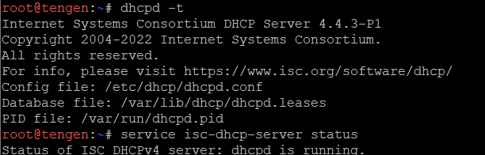

*Keterangan: `dhcpd -t` bersih dan service berjalan.*

Hasil client:

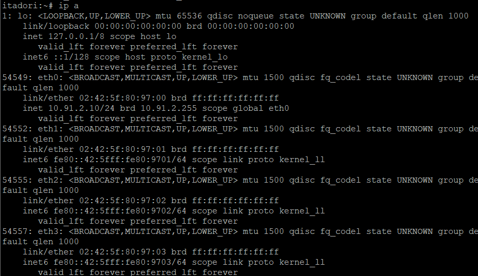

*Keterangan: itadori memperoleh `10.91.2.10` (Pool 1).*

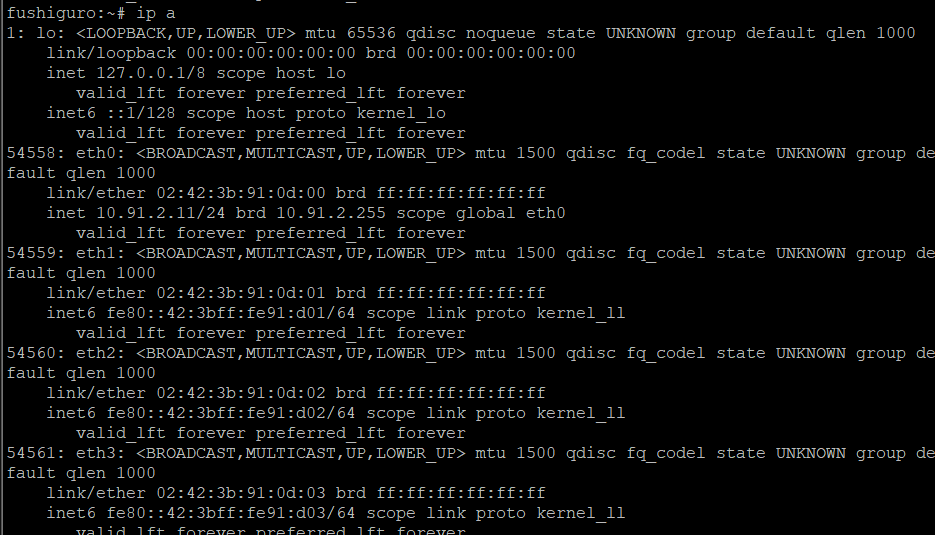

*Keterangan: fushiguro memperoleh `10.91.2.11` (Pool 1).*

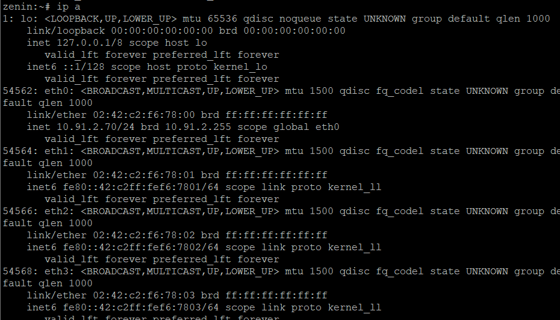

*Keterangan: zenin memperoleh `10.91.2.70` (Pool 2).*

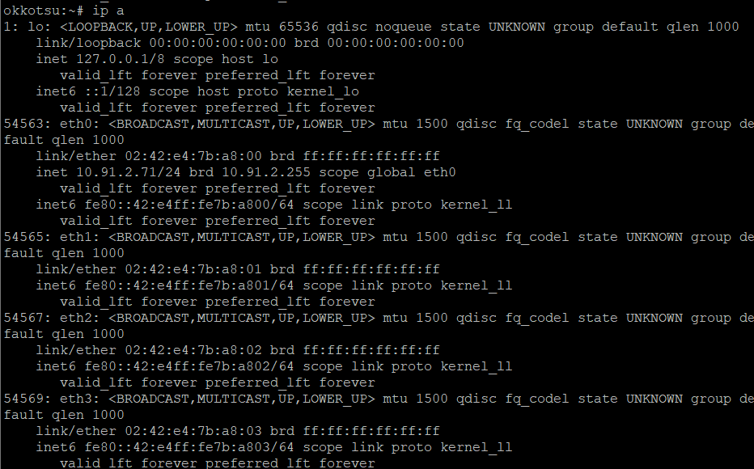

*Keterangan: okkotsu memperoleh `10.91.2.71` (Pool 2).*

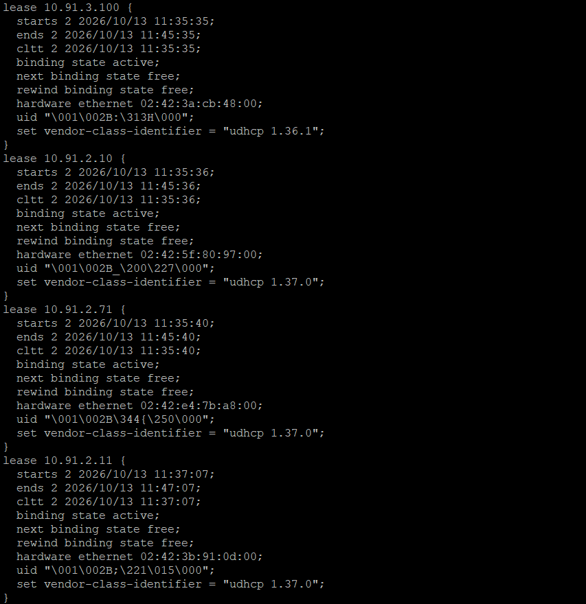

*Keterangan: `dhcpd.leases` di tengen memuat keempat lease dengan IP dan MAC sesuai pool.*

### Troubleshooting

- `dhcpd.conf` sempat kembali ke isi bawaan (seluruh subnet berkomentar) sehingga service gagal start dengan `No subnet declaration for eth0 (10.91.4.10)`. Diperbaiki dengan menulis ulang file lalu menjalankan service.
- Paste konfigurasi panjang di console GNS3 sempat terpotong, sehingga konfigurasi ditulis per blok memakai `cat >` dan `cat >>`.
- Paket `isc-dhcp-relay` di jichi sempat hilang sehingga client tidak mendapat lease. Diperbaiki dengan memasang ulang paket dan mengisi kembali `/etc/default/isc-dhcp-relay`.

---

## Soal 5

### Tujuan

Pada Network 3, ino dan kusakabe mendapat short lease 1800 detik, sedangkan miwa mendapat long lease 43200 detik. Diberikan juga DHCP options DNS `10.91.1.2` dan `10.91.1.3` serta domain-search `K55.com`.

| Client | MAC | Class | Pool | Lease |
|---|---|---|---|---|
| ino | `02:42:3a:cb:48:00` | short | `10.91.3.10`-`.89` | 1800 s |
| kusakabe | `02:42:34:fd:cc:00` | short | `10.91.3.10`-`.89` | 1800 s |
| miwa | `02:42:f7:ab:22:00` | long | `10.91.3.100`-`.199` | 43200 s |

### Konfigurasi Network 3

```conf
class "short" {
    match if (substring(hardware, 1, 6) = 02:42:3a:cb:48:00)
          or (substring(hardware, 1, 6) = 02:42:34:fd:cc:00);
}

class "long" {
    match if (substring(hardware, 1, 6) = 02:42:f7:ab:22:00);
}

subnet 10.91.3.0 netmask 255.255.255.0 {
    option routers 10.91.3.1;
    option subnet-mask 255.255.255.0;
    option broadcast-address 10.91.3.255;
    option domain-name-servers 10.91.1.2, 10.91.1.3;
    option domain-search "K55.com";

    pool {
        allow members of "short";
        range 10.91.3.10 10.91.3.89;
        default-lease-time 1800;
        max-lease-time 1800;
    }

    pool {
        allow members of "long";
        range 10.91.3.100 10.91.3.199;
        default-lease-time 43200;
        max-lease-time 43200;
    }
}
```

Bagian Network 4 dan Network 2 tidak berubah dari soal 4. Setelah perubahan, lease lama dikosongkan agar client meminta ulang.

### Verifikasi

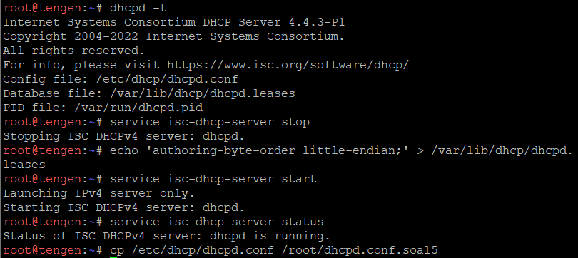

*Keterangan: `dhcpd -t` bersih dan service berjalan setelah konfigurasi diubah.*

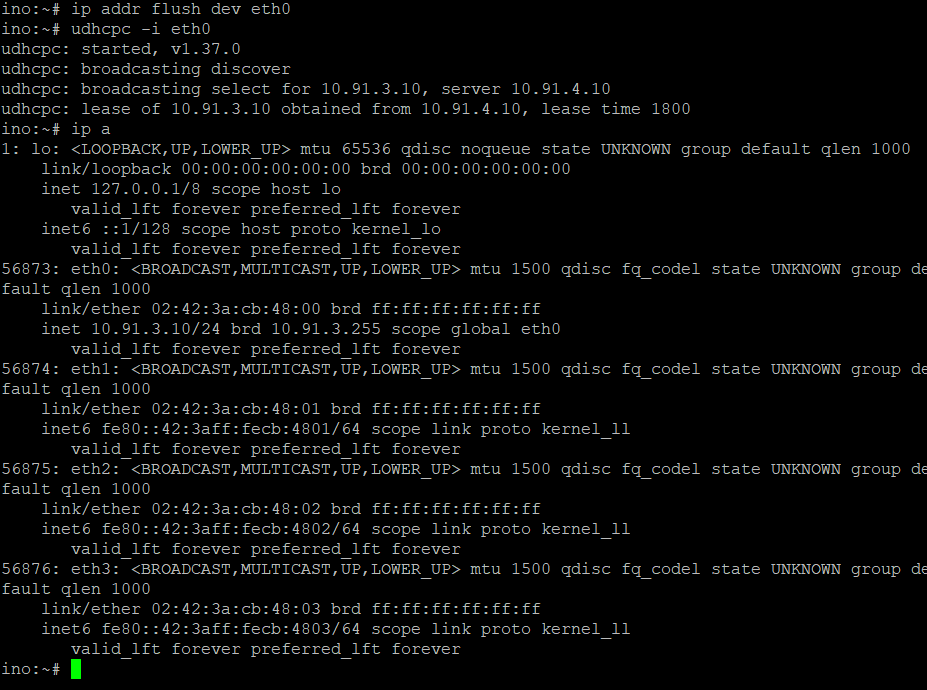

*Keterangan: ino memperoleh IP pada rentang `10.91.3.10`-`.89`.*

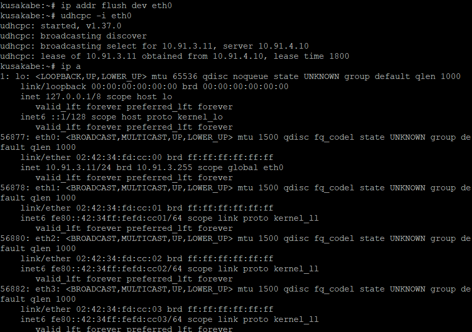

*Keterangan: kusakabe memperoleh IP pada rentang `10.91.3.10`-`.89`.*

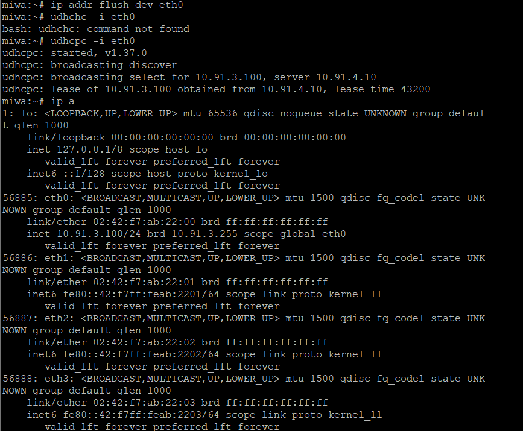

*Keterangan: miwa memperoleh IP pada rentang `10.91.3.100`-`.199`.*

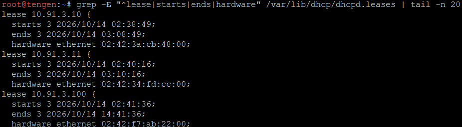

*Keterangan: Lease di tengen. Selisih `starts` dan `ends` 30 menit untuk ino dan kusakabe, serta 12 jam untuk miwa.*

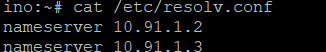

*Keterangan: Bukti DHCP options (DNS `10.91.1.2`, `10.91.1.3` dan domain-search `K55.com`).*

DNS `10.91.1.2` dan `10.91.1.3` adalah utahime dan shoko. Layanan DNS-nya dikerjakan pada soal DNS, sehingga pada soal ini yang dibuktikan hanya pemberian option melalui DHCP.

---

## Soal 6

### Tujuan

kugisaki (VIP) harus selalu memperoleh `10.91.3.99` berdasarkan MAC address. Alamat ini berada di celah antara pool short (`.10`-`.89`) dan long (`.100`-`.199`), sehingga di luar seluruh pool dinamis.

### Konfigurasi (ditambahkan di akhir `dhcpd.conf`)

```conf
host kugisaki {
    hardware ethernet 02:42:e2:08:eb:00;
    fixed-address 10.91.3.99;
}
```

```bash
dhcpd -t
service isc-dhcp-server restart
```

Di kugisaki, lease diperbarui dengan:

```bash
ip addr flush dev eth0
udhcpc -i eth0
```

### Verifikasi

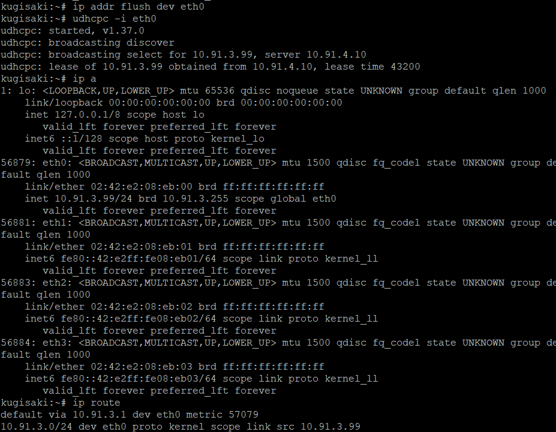

*Keterangan: kugisaki memperoleh `10.91.3.99/24`.*

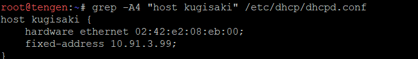

*Keterangan: Blok `host kugisaki` pada `dhcpd.conf` di tengen.*

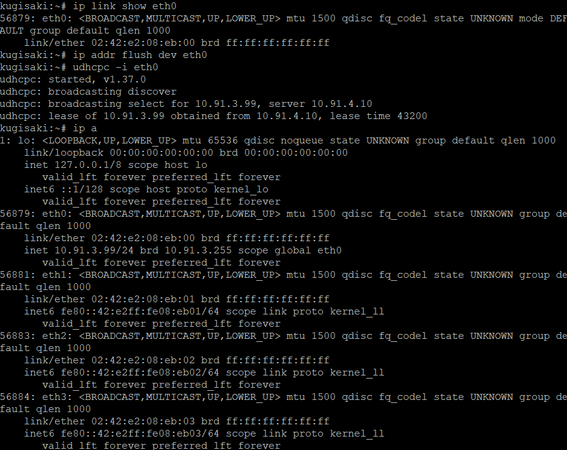

*Keterangan: MAC eth0 kugisaki sama dengan MAC pada blok host, dan setiap renew tetap menghasilkan `10.91.3.99`.*

Static lease (host reservation) tidak dicatat sebagai entri `lease` di `dhcpd.leases`, sehingga `grep "lease 10.91.3.99"` tidak menghasilkan output. Bukti diambil dari `ip a` di client, MAC pada blok host, dan renew yang konsisten.

---

## Soal 7

### Tujuan

Memastikan seluruh client Divisi A dan B menerima subnet mask /24, gateway, broadcast, DNS `10.91.1.2` dan `10.91.1.3`, serta domain-search yang benar, lalu mencocokkan lease dengan `dhcpd.leases`.

### Penyesuaian di tengen

Network 2 sebelumnya masih memakai DNS `8.8.8.8` tanpa domain-search. Agar sama dengan Network 3, DNS dan domain-search diperbarui:

```bash
sed -i 's/option domain-name-servers 8.8.8.8;/option domain-name-servers 10.91.1.2, 10.91.1.3;\n    option domain-search "K55.com";/' /etc/dhcp/dhcpd.conf
dhcpd -t
service isc-dhcp-server restart
cp /etc/dhcp/dhcpd.conf /root/dhcpd.conf.soal7
```

### Hasil yang diharapkan

| Client | IP | Gateway | Broadcast |
|---|---|---|---|
| itadori, fushiguro | `10.91.2.10`-`.35` | `10.91.2.1` | `10.91.2.255` |
| zenin, okkotsu | `10.91.2.70`-`.95` | `10.91.2.1` | `10.91.2.255` |
| ino, kusakabe | `10.91.3.10`-`.89` | `10.91.3.1` | `10.91.3.255` |
| miwa | `10.91.3.100`-`.199` | `10.91.3.1` | `10.91.3.255` |
| kugisaki | `10.91.3.99` | `10.91.3.1` | `10.91.3.255` |

### Verifikasi client

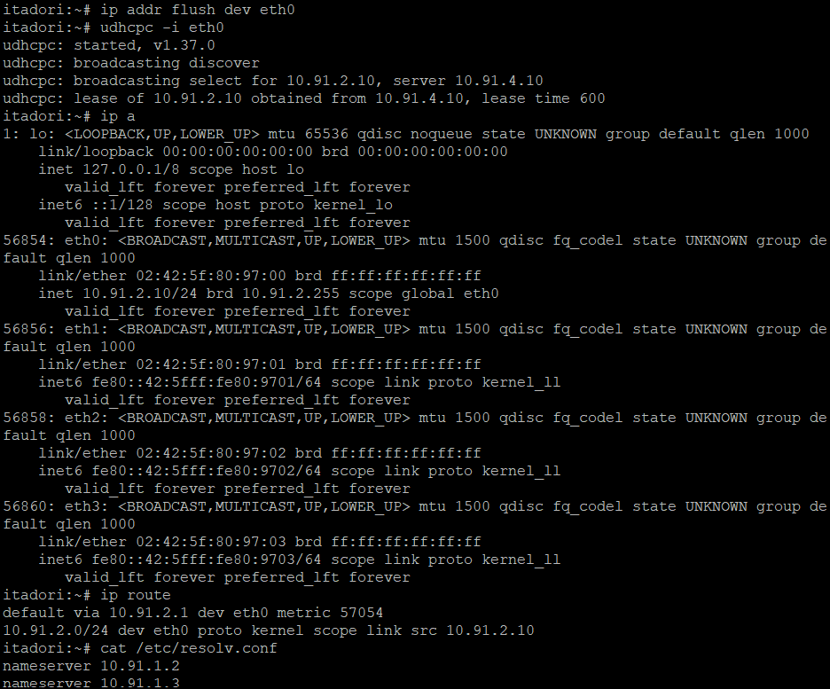

*Keterangan: itadori, IP, gateway, dan broadcast Network 2.*

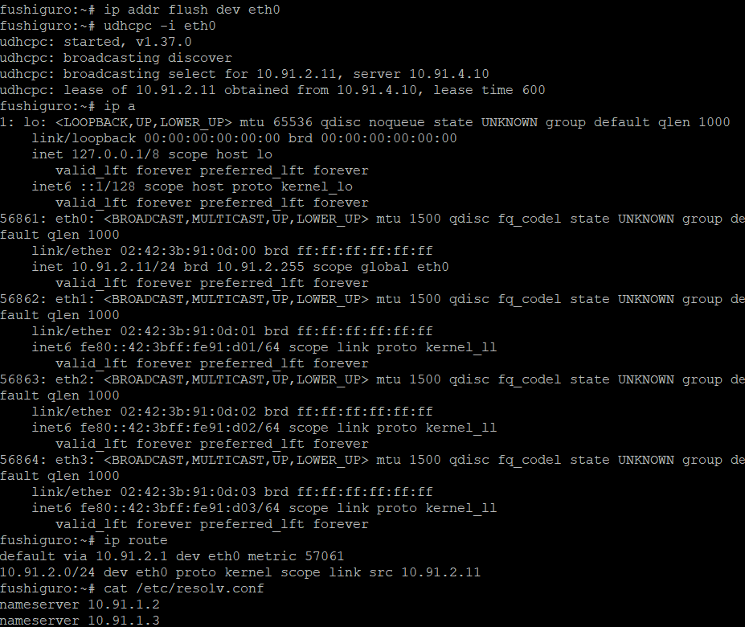

*Keterangan: fushiguro, IP, gateway, dan broadcast Network 2.*

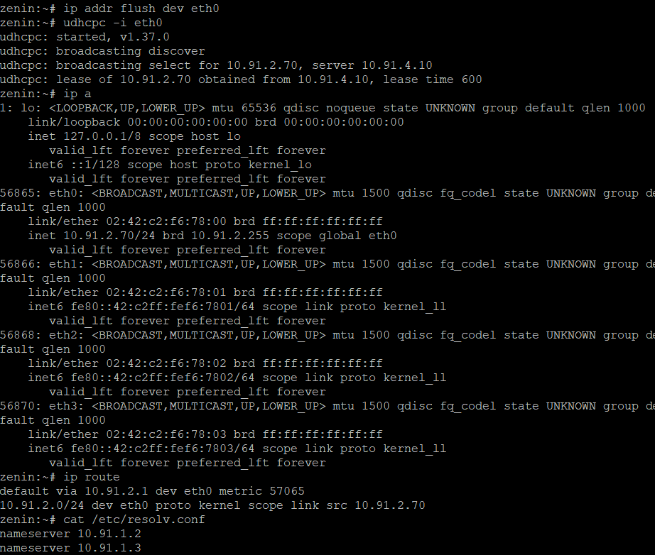

*Keterangan: zenin, IP, gateway, dan broadcast Network 2.*

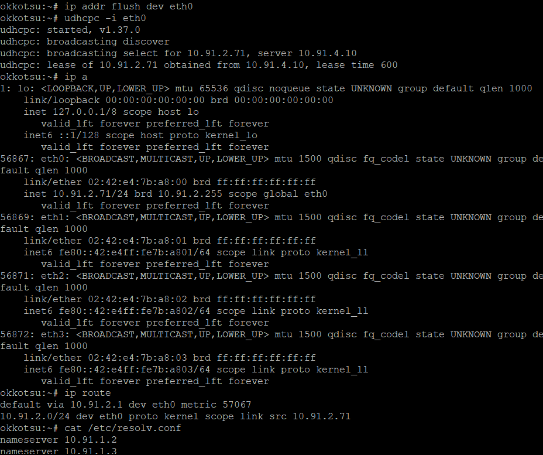

*Keterangan: okkotsu, IP, gateway, dan broadcast Network 2.*

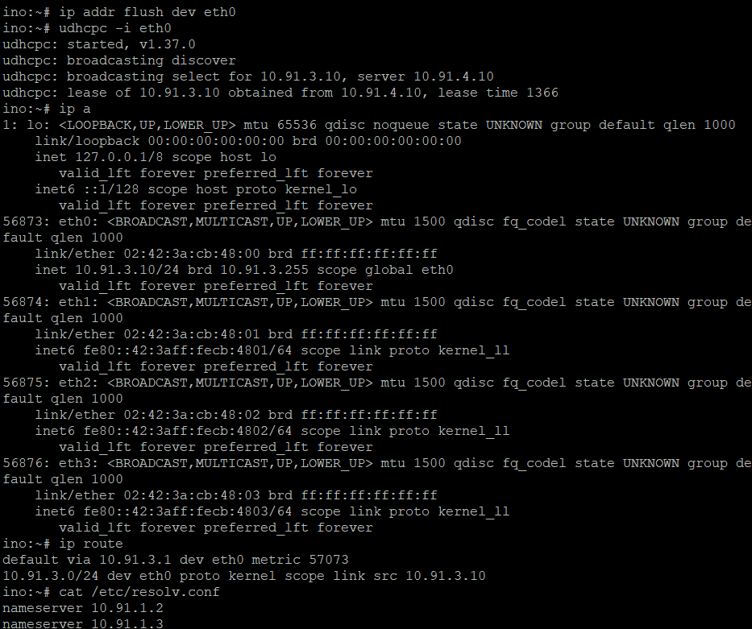

*Keterangan: ino, IP, gateway, dan broadcast Network 3.*

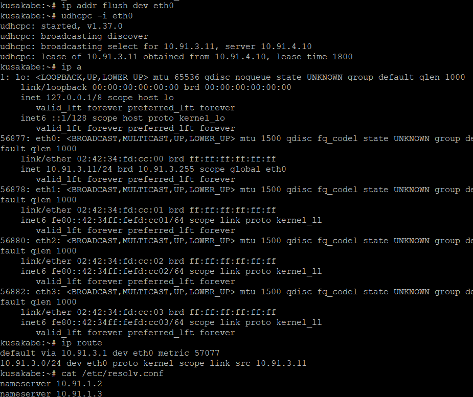

*Keterangan: kusakabe, IP, gateway, dan broadcast Network 3.*

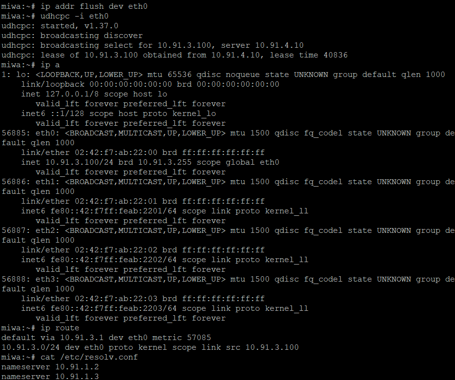

*Keterangan: miwa, IP, gateway, dan broadcast Network 3.*

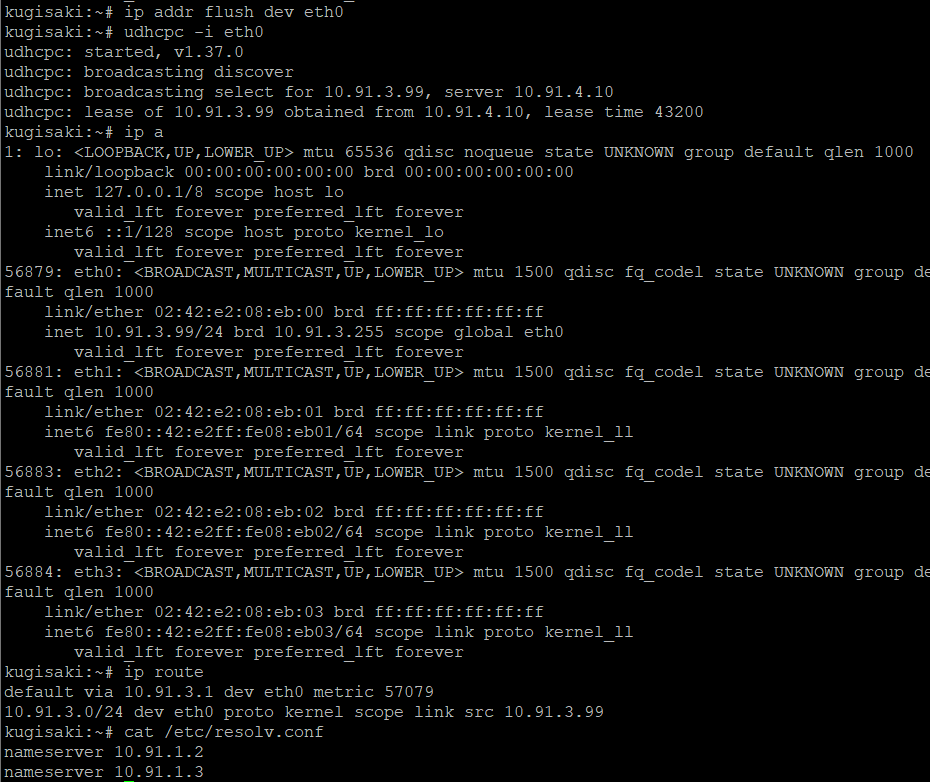

*Keterangan: kugisaki, `10.91.3.99`, gateway, dan broadcast Network 3.*

### Kecocokan dengan `dhcpd.leases`

```bash
awk '/^lease/{ip=$2; mac=""} /hardware ethernet/{gsub(";","",$3); mac=$3} /^}/{print ip, mac}' /var/lib/dhcp/dhcpd.leases | sort -u
```

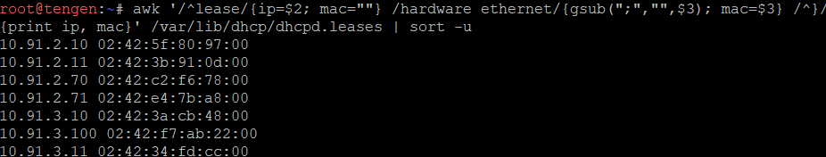

*Keterangan: Setiap IP hanya memiliki satu MAC, tidak ada IP yang bertabrakan, dan tidak ada IP di luar kebijakan pool.*

---

## Soal 8

### Tujuan

Membuktikan proses pemberian alamat berjalan sesuai protokol dengan capture saat client meminta lease baru, lalu mengidentifikasi server, alamat yang diberikan, lease time, dan `giaddr`.

### Langkah

Di tengen:

```bash
tcpdump -i eth0 -n -vvv -c 4 -w /root/dhcp-dora.pcap 'udp port 67 or udp port 68'
```

Di itadori (setelah tcpdump menunggu):

```bash
ip addr flush dev eth0
udhcpc -i eth0
```

Hasil dibaca dengan:

```bash
tcpdump -n -vvv -r /root/dhcp-dora.pcap
```

### Hasil (xid `0x4119904f`)

| Paket | Arah | Informasi |
|---|---|---|
| DHCPDISCOVER | `10.91.4.1` -> `10.91.4.10` | Gateway-IP `10.91.2.1`, MAC `02:42:5f:80:97:00` |
| DHCPOFFER | `10.91.4.10` -> `10.91.2.1` | Your-IP `10.91.2.10`, Server-ID `10.91.4.10`, Lease-Time 600 |
| DHCPREQUEST | `10.91.4.1` -> `10.91.4.10` | Requested-IP `10.91.2.10`, Server-ID `10.91.4.10` |
| DHCPACK | `10.91.4.10` -> `10.91.2.1` | Your-IP `10.91.2.10`, Lease-Time 600 |

| Item | Nilai |
|---|---|
| Alamat server | `10.91.4.10` (tengen) |
| Alamat diberikan | `10.91.2.10` |
| Lease time | 600 detik |
| giaddr | `10.91.2.1` (interface `eth2` jichi) |

Pada output tcpdump, field `giaddr` ditulis sebagai `Gateway-IP`. Nilainya sama dengan IP interface jichi yang menerima request dari subnet client (`eth2` = `10.91.2.1`). Paket antara jichi dan tengen berupa unicast, bukti relay meneruskan request dan mengisi `giaddr`.

### Verifikasi


*Keterangan: Output `tcpdump -n -vvv -r /root/dhcp-dora.pcap` yang menampilkan empat paket DORA.*

Ringkasan field penting dengan:

```bash
tcpdump -n -vvv -r /root/dhcp-dora.pcap | grep -E "BOOTP|Your-IP|Gateway-IP|DHCP-Message|Server-ID|Lease-Time"
```


*Keterangan: Baris penting hasil filter: `Gateway-IP 10.91.2.1`, `Your-IP 10.91.2.10`, `Server-ID 10.91.4.10`, `Lease-Time 600`, dan empat jenis `DHCP-Message`.*


*Keterangan: itadori memperoleh `10.91.2.10` setelah lease baru.*

---

## Soal 9

### Tujuan

Menghentikan relay di jichi, mencatat gejala saat client meminta lease, lalu memulihkan relay dan membuktikan client kembali mendapat alamat dari pool yang benar dengan gateway semula.

### Langkah

```bash
# jichi: kondisi awal
ps aux | grep dhcrelay

# jichi: gangguan
service isc-dhcp-relay stop
ps aux | grep dhcrelay

# itadori: minta lease saat relay mati
ip addr flush dev eth0
udhcpc -i eth0 -n -q
ip a show eth0
ip route

# jichi: pemulihan
service isc-dhcp-relay start
ps aux | grep dhcrelay

# itadori: minta lease lagi
udhcpc -i eth0
ip a show eth0
ip route
```

### Verifikasi


*Keterangan: Kondisi awal di jichi, proses `dhcrelay` masih berjalan.*


*Keterangan: `ip a` dan `ip route` itadori sebelum gangguan.*


*Keterangan: Relay dihentikan di jichi dan proses `dhcrelay` tidak ada lagi.*


*Keterangan: itadori meminta lease saat relay mati. `udhcpc` hanya `broadcasting discover`, `eth0` tanpa `inet`, dan tidak ada default route.*


*Keterangan: Relay dijalankan kembali dan proses `dhcrelay` muncul.*


*Keterangan: itadori kembali memperoleh `10.91.2.10` dengan gateway `10.91.2.1`.*

```bash
grep -E "^lease|hardware" /var/lib/dhcp/dhcpd.leases | tail -n 4
```


*Keterangan: Lease itadori tercatat kembali di tengen setelah relay dipulihkan.*

### Analisis

Discover dari client berupa broadcast yang tidak menyeberangi router. Tanpa relay di jichi, request tidak pernah sampai ke tengen di Network 4, sehingga client tidak memperoleh IP. Setelah relay aktif kembali, request diteruskan secara unicast dan client memperoleh `10.91.2.10` (Pool 1) dengan gateway `10.91.2.1` seperti kondisi awal.

---

## Soal 10

### Tujuan

Memastikan pemulihan bertahan setelah restart: autostart DHCP Server di tengen dan DHCP Relay di jichi, lalu memverifikasi service, IP, gateway, lease, dan kebijakan pool.

### Autostart

```bash
# tengen
systemctl enable isc-dhcp-server 2>/dev/null || update-rc.d isc-dhcp-server defaults
systemctl is-enabled isc-dhcp-server 2>/dev/null
ls /etc/rc2.d | grep dhcp

# jichi
systemctl enable isc-dhcp-relay 2>/dev/null || update-rc.d isc-dhcp-relay defaults
ls /etc/rc2.d | grep relay
```


*Keterangan: Autostart terdaftar di tengen dan jichi.*

### Script pemulihan `/root/startup.sh`

Karena paket dan konfigurasi di `/etc` dapat hilang setelah restart, disiapkan script pemulihan.

tengen:

```bash
#!/bin/bash
sleep 5
echo "nameserver 192.168.122.1" > /etc/resolv.conf
which dhcpd >/dev/null 2>&1 || { apt-get update; apt-get install isc-dhcp-server -y; }
cp /root/dhcpd.conf.soal7 /etc/dhcp/dhcpd.conf
echo 'INTERFACESv4="eth0"' > /etc/default/isc-dhcp-server
update-rc.d isc-dhcp-server defaults
service isc-dhcp-server restart
```

jichi:

```bash
#!/bin/bash
sleep 5
echo "nameserver 192.168.122.1" > /etc/resolv.conf
sysctl -w net.ipv4.ip_forward=1
iptables -t nat -C POSTROUTING -o eth0 -j MASQUERADE 2>/dev/null || iptables -t nat -A POSTROUTING -o eth0 -j MASQUERADE
which dhcrelay >/dev/null 2>&1 || { apt-get update; apt-get install isc-dhcp-relay -y; }
cp /root/isc-dhcp-relay.soal3 /etc/default/isc-dhcp-relay
update-rc.d isc-dhcp-relay defaults
service isc-dhcp-relay restart
```

Cadangan konfigurasi yang dipakai: `/root/dhcpd.conf.soal7` (tengen) dan `/root/isc-dhcp-relay.soal3` (jichi).

### Verifikasi setelah restart


*Keterangan: tengen setelah restart: `service isc-dhcp-server status`, `ip a show eth0`, dan `dhcpd -t`.*


*Keterangan: jichi setelah restart: proses `dhcrelay`, `ip_forward`, dan aturan MASQUERADE.*

**Client Divisi A** (`ip a show eth0`, `ip route`, ping gateway):


*Keterangan: itadori, IP pada Pool 1 dan gateway `10.91.2.1`.*


*Keterangan: fushiguro, IP pada Pool 1 dan gateway `10.91.2.1`.*


*Keterangan: zenin, IP pada Pool 2 dan gateway `10.91.2.1`.*


*Keterangan: okkotsu, IP pada Pool 2 dan gateway `10.91.2.1`.*

**Client Divisi B:**


*Keterangan: ino, short lease, IP pada `10.91.3.10`-`.89`.*


*Keterangan: kusakabe, short lease, IP pada `10.91.3.10`-`.89`.*


*Keterangan: miwa, long lease, IP pada `10.91.3.100`-`.199`.*


*Keterangan: kugisaki tetap memperoleh `10.91.3.99` (fixed address).*

**Kebijakan pool dan lease di tengen:**

```bash
awk '/^lease/{ip=$2; mac=""} /hardware ethernet/{gsub(";","",$3); mac=$3} /^}/{print ip, mac}' /var/lib/dhcp/dhcpd.leases | sort -u
```


*Keterangan: Tidak ada IP di luar kebijakan pool dan setiap IP hanya memiliki satu MAC.*

```bash
grep -E "^lease|starts|ends|hardware" /var/lib/dhcp/dhcpd.leases | tail -n 20
```


*Keterangan: Selisih `starts` dan `ends` 30 menit untuk ino dan kusakabe, 12 jam untuk miwa, dan 10 menit untuk client Divisi A.*

### Gangguan

- Setelah restart, IP statis tetap karena dibaca dari `/etc/network/interfaces`, begitu pula seluruh file di `/root`.
- Paket `isc-dhcp-relay` (jichi) dan `isc-dhcp-server` (tengen) dapat hilang setelah restart, sehingga dipulihkan dengan `/root/startup.sh` yang memasang ulang paket dan memulihkan konfigurasi dari cadangan.
- Setelah restart, link Network 4 sempat belum stabil (ping tengen ke jichi sempat loss 60%) sehingga client gagal `udhcpc`. Ping ulang sampai 0% loss, restart bersih relay (`killall dhcrelay; service isc-dhcp-relay start`), lalu minta lease ulang.

### Urutan pemulihan setelah restart

| Urutan | Node | Aksi |
|---|---|---|
| 1 | jichi | `/root/startup.sh`, lalu cek `ps aux \| grep dhcrelay` |
| 2 | tengen | `/root/startup.sh`, lalu cek `service isc-dhcp-server status` |
| 3 | tengen | `ping -c 10 10.91.4.1` sampai 0% loss |
| 4 | jichi | `killall dhcrelay; service isc-dhcp-relay start` bila perlu |
| 5 | client | `udhcpc -i eth0` |

---

